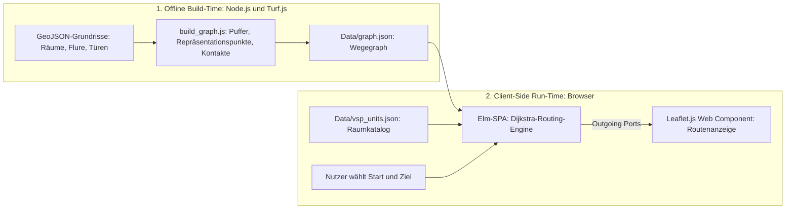

Willkommen in der Dokumentation von **KrokenKompass**!

**KrokenKompass** ist ein clientseitiges **Indoor- & Campus-Navigationssystem** ohne Zusatzhardware für die **Martin-Luther-Universität Halle-Wittenberg (MLU)**, fokussiert auf den **Heide-Campus** (u. a. Von-Seckendorff-Platz 1–4, Gebäudecodes `7721`–`7724`).

---

## 🗺️ Inhaltsverzeichnis

* [⚙️ **Backend & Graphenerstellung**](⚙️-Backend-&-Graphenerstellung) – Geometrieverarbeitung mit Turf.js, Pufferzonen, Kantenberechnung & Strafmetriken.
* [🎨 **UI, Theming & Design-System**](🎨-UI,-Theming-&-Design‐System) – Dual-Logo-System, Dark-/Light-Mode, Bulma 1.0 & Responsive Design.
* [🏗️ **Architektur & Technologien**](🏗️-Architektur-&-Technologien) – Systemübersicht, Build- vs. Run-Time, Verzeichnisstruktur & Komponenten.
* [🖥️ **Frontend & Elm-Architektur**](🖥️-Frontend-&-Elm‐Architektur) – Die Elm-SPA, Dijkstra-Routing im Browser, Port-Kommunikation & Leaflet-Kartenanzeige.
* [🚀 **Deployment & CI/CD-Pipelines**](🚀-Deployment-&-CI-CD-Pipelines) – GitHub Pages Workflow, Vercel-Konfiguration & automatisierte Build-Pipelines.
* [🛠️ **Installation & Developer Guide**](🛠️-Installation-&-Developer-Guide) – Lokale Einrichtung, Entwicklungsworkflow & Troubleshooting.

---

## 💡 Motivation & Architekturansatz

Herkömmliche Indoor-Navigationssysteme stehen häufig vor zwei Hürden:
1. **Zusätzliche Hardware-Infrastruktur:** Abhängigkeit von Bluetooth-Beacons, Ultra-Wideband (UWB) oder WLAN-Fingerprinting.
2. **Serverseitige Rechenlast:** Polygon-Schnitte und Pfadberechnungen bei jeder einzelnen Suchanfrage erhöhen Latenz und Betriebskosten.

**KrokenKompass trennt Geometrie-Vorverarbeitung und Laufzeit-Routing in zwei Stufen:**

1. **Offline-Vorverarbeitung:** Räumliche GeoJSON-Geometrien (`Data/vsp_etage_-1.json` bis `05.json`) werden vorab analysiert und in einen gewichteten Wegegraphen (`Data/graph.json`) überführt.
2. **Client-Side-Routing:** Der Browser lädt den statischen Graphen einmalig herunter. Das Routing (`Dijkstra.shortestPath`) läuft lokal im Browser via [Elm](https://elm-lang.org/) ohne Serveranfragen zur Laufzeit.

---

## 📊 Kernmetriken

* **Frontend:** Elm 0.19.1 + Leaflet.js 1.9.4 + Turf.js 6.5.0 (CDN) + Bulma 1.0.4
* **Backend / Pre-Processing:** Node.js (v18+, CI: v24) + `@turf/turf` 7.4.0
* **Routing-Algorithmus:** Dijkstra (clientseitig in Elm ausgeführt)
* **Abgedeckte Etagen:** 7 Etagen (`-1` Untergeschoss bis `05` 5. Obergeschoss) über VSP 1–4 (`7721`–`7724`)

---
*Navigation:* [⚙️ Weiter zu Backend & Graphenerstellung →](⚙️-Backend-&-Graphenerstellung)
