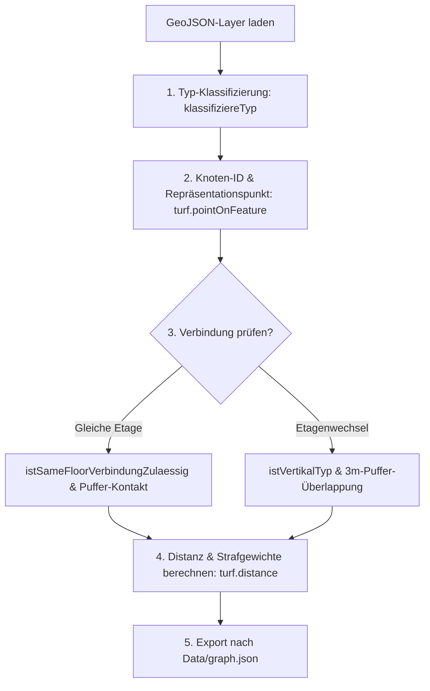

Das Backend von KrokenKompass ist ein **Build-Time-Skript** in Node.js (`Code/backend/build_graph.js`). Seine Aufgabe ist es, zweidimensionale Raum-Polygone in ein mathematisches Wegenetzwerk (einen ungerichteten, gewichteten Graphen) zu transformieren.

---

## 📂 Rohdaten & GeoJSON-Struktur

Die Grundrisse liegen als GeoJSON-Dateien (`EPSG:4326` / WGS84) im Ordner `Data/` vor:
* `vsp_etage_-1.json` (Untergeschoss)
* `vsp_etage_00.json` (Erdgeschoss)
* `vsp_etage_01.json` bis `vsp_etage_05.json` (1. bis 5. Obergeschoss)

Jedes Feature (Polygon) enthält Metadaten aus dem PostGIS-Export:
```json
{
  "type": "Feature",
  "properties": {
    "gid": 123,
    "unit_id": 17,
    "name": "7724_00_017",
    "use_type": "Tuer",
    "level_id": 4,
    "area": 2.45
  },
  "geometry": { "type": "Polygon", "coordinates": [...] }
}
```
Aus dem Präfix von `properties.name` (`BBBB_EE_RRR`) leitet `build_graph.js` die Gebäudekennung (`gebaeude`: `7721` = VSP 1, `7722` = VSP 2, `7723` = VSP 3, `7724` = VSP 4 am Von-Seckendorff-Platz) ab; die Etage (`etage`, z. B. `"00"`) ergibt sich aus der eingelesenen Datei `vsp_etage_<etage>.json`.

---

## 🧠 Der Transformationsprozess (`build_graph.js`)



### 1. Typ-Klassifizierung (`klassifiziereTyp`) & Knoten-ID (`erstelleKnotenId`)
Die Rohdaten-Werte in `use_type` werden normiert (Kleinschreibung, NFD-Diakritika-Bereinigung):
* `tuer`, `eingang`, `lobby`, `durchgang`
* `vertikal` (Treppenhäuser, Treppen, Aufzüge)
* `flur` (Gänge, Flure)
* `raum` (Hörsäle, Seminarräume, Büros, Labore) bzw. spezifische Einheiten (`wc d`, `wc h`)

Jedes benannte Polygon erhält eine deterministische Knoten-ID im Format `${name}__${gid}` (Fallback `${name}__${index}`), die exakt mit der ID-Generierung in `Code/frontend/map-view.js` übereinstimmt.

### 2. Ermittlung des Repräsentationspunkts (`centroids`)
Für jedes Feature wird ein Punkt garantiert innerhalb der Polygonfläche ermittelt (`turf.pointOnFeature`), mit `turf.centroid` als Fallback:
```javascript
let pt;
try {
    pt = turf.pointOnFeature(feature);
} catch (err) {
    pt = turf.centroid(feature);
}
```

### 3. Kantenfindung & Pufferzonen (Toleranzen)
CAD-Pläne weisen oft minimale Lücken (wenige Zentimeter) zwischen Türen und Fluren auf. Ohne Toleranzpuffer würden Räume isoliert bleiben. Zudem prüft `istSameFloorVerbindungZulaessig`, welche Typen auf derselben Etage direkt verbunden werden dürfen (z. B. kein direkter Kontakt `tuer ↔ vertikal` oder `raum ↔ raum`).

* **Standard-Innenraumpuffer (gleiches Gebäude, gleiche Etage):** `1.0 Meter`  
  *Stellt sicher, dass Türen, Räume und Innenflure zuverlässig Kanten bilden (u. a. in Gebäude 7724 / VSP 4).*
* **Erweiterter Wege- & Gebäudeübergangspuffer:** `3.0 Meter`  
  *Verbindet breite Übergänge (`flur`, `durchgang`, `eingang`, `vertikal`) sowie gebäudeübergreifende Kontakte (`gebaeude1 !== gebaeude2`) über Türen oder Flure.*
* **Vertikalpuffer (Treppen/Aufzüge zwischen benachbarten Etagen):** `3.0 Meter`  
  *Verbindet `vertikal`-Polygone bei `|stockwerk1 - stockwerk2| === 1`.*

### 4. Heuristiken & Strafdistanzen (Penalties)

Ohne Kantengewichtung würde der Dijkstra-Algorithmus angrenzende Räume als Abkürzung (Transitknoten) nutzen.

| Verbindungstyp | Distanzberechnung | Zweck |
| :--- | :--- | :--- |
| **Flur ↔ Flur / Tür / Durchgang** | Reale Distanz (Meter) | Bevorzugter Standardweg über Flure und Türen. |
| **Kante mit Raum-Beteiligung (`typ === "raum"`)** | Reale Distanz **+ 5.000 m** | Verhindert Raum-Transit ("Büro-Hopping"). Ein Raum-Polygon wird nur betreten, wenn es selbst Start oder Ziel ist (reguläre Routen starten/enden bereits am `tuer`-Knoten des Raums). |
| **Tür ↔ Tür (`tuer ↔ tuer`)** | Reale Distanz **+ 500 m** | Verhindert unnötiges Schneiden über unmittelbar benachbarte Türpolygone. |
| **Etagenwechsel (`vertikal ↔ vertikal`)** | Fixkosten **5 m** | Modelliert den Aufwand für Treppen- oder Aufzugsnutzung zur Nachbaretage. |

---

## 📄 Struktur der Ausgabedatei (`Data/graph.json`)

Beispielausschnitt aus `Data/graph.json`:

```json
{
  "graph": {
    "7724_00_017__123": {
      "7724_00_001__456": 4.82,
      "7724_00_017__789": 5003.12
    }
  },
  "centroids": {
    "7724_00_017__123": [11.94215, 51.49812]
  },
  "nodeMeta": {
    "7724_00_017__123": {
      "name": "7724_00_017",
      "typ": "tuer",
      "rawTyp": "tuer",
      "gebaeude": "7724",
      "etage": "00"
    }
  }
}
```

---
*Navigation:* [← 🏠 Zurück zur Home-Seite](Home) | [🎨 Weiter zu UI, Theming & Design-System →](🎨-UI,-Theming-&-Design‐System)
