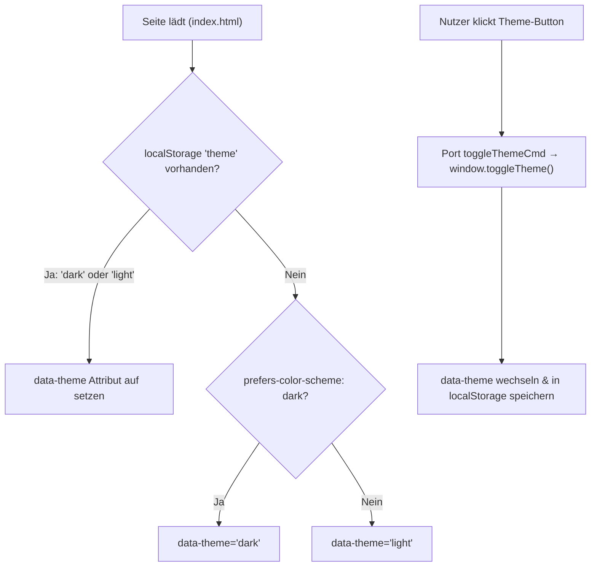

KrokenKompass setzt auf ein kontraststarkes, übersichtliches Interface, das sowohl auf Desktop-Bildschirmen als auch auf mobilen Endgeräten (Smartphones auf dem Campus) konsistent bedienbar ist.

---

## 🌓 Dark-/Light-Mode-Architektur

Das Theme-System unterstützt sowohl die **automatische Erkennung der Systemeinstellung (`prefers-color-scheme`)** als auch das **manuelle Umschalten** über den Header-Button.



### CSS-Variablen & Bulma-Integration (`style.css` & `index.html`)
Die globalen Farb- und Layout-Regeln sind in `Code/frontend/cssFiles/style.css` sowie im `<style>`-Block von `index.html` definiert:
```css
:root {
    --figma-blue: #007AFF;
    --bulma-info: var(--figma-blue);
    --bulma-info-invert: #ffffff;
    --button-light-bg: #f2f2f7;
}

html[data-theme="dark"] {
    --bulma-info: #64D2FF;
    --bulma-info-invert: #000000;
    --button-light-bg: #2C2C2E;
}
```

---

## 🧭 Das Dual-Logo-System

Um auf hellen und dunklen Oberflächen ausreichenden Kontrast sicherzustellen, bindet die UI zwei angepasste Logo-Varianten ein:

| Theme | Hintergrund | Verwendetes Logo | Datei |
| :--- | :--- | :--- | :--- |
| **Light Mode** | Hell (`#FFFFFF`) | **Dunkles Logo** | `Code/frontend/svgs/KK-Logo-dark.png` |
| **Dark Mode** | Dunkel (`#1C1C1E`) | **Helles Logo** | `Code/frontend/svgs/KK-Logo-Light.png` |
| **Favicon** | Browser-Tab | **Statisches dunkles Logo** | `Code/frontend/svgs/KK-Logo-dark.png` |

### CSS-Switching-Logik
Die Sichtbarkeit der beiden ``-Elemente (`.logo-light-mode` und `.logo-dark-mode`) wird rein über CSS gesteuert, sodass beim Laden der Seite kein Flackern auftritt:
```css
html[data-theme="dark"] .logo-light-mode { display: none !important; }
html[data-theme="dark"] .logo-dark-mode { display: inline-block !important; }
html:not([data-theme="dark"]) .logo-light-mode { display: inline-block !important; }
html:not([data-theme="dark"]) .logo-dark-mode { display: none !important; }
```

---

## 📱 Responsive Layout & UI-Komponenten

### 1. Expanding Route Pill (`.route-pill`)
Die Sucheingabefelder für Start und Ziel auf der `#plan`-Ansicht sind als abgerundete Pill-Komponenten mit Fokus-Hervorhebung, Swap-Button (`#swapBtn`), Schnellauswahl für den Campus-Eingang (`LocationFill`) und animierten Autocomplete-Dropdowns (`.search-dropdown`) gestaltet.

### 2. Schwebendes Etagen-Auswahlmenü (`#etagen-menue`)
Ein vertikales Overlay-Menü am **linken** Bildschirmrand (`top: 100px; left: 48px`) auf der Kartenansicht (`#map`) ermöglicht den Wechsel zwischen den Etagen (`5`, `4`, `3`, `2`, `1`, `EG / 0`, `-1`) mit Hervorhebung der aktiven Etage (`.etagen-btn.active`).

### 3. Footer & Versionsanzeige
Die Fußleiste am unteren Bildschirmrand zeigt neben dem Logo und dem GitHub-Link die **Release- und Build-Informationen** an:
* Format: `vX.X.X - XXXXXXX`
* Die Release-Version verlinkt auf das neueste GitHub-Release (`/releases/latest`), während der 7-stellige Git-Commit-Hash direkt auf den jeweiligen Commit (`/commit/XXXXXXX`) verlinkt.

### 4. Responsive Breakpoints
* **Desktop (≥ 769px):** Vollständige Header- und Footer-Leiste, symmetrische Hero-Aktionsbuttons (`min-width: 180px`).
* **Mobile (≤ 768px):** Angepasste Schriftgrößen (`.hero-title-custom` auf `2.25rem`), vertikal gestapelte Buttons in voller Breite und kompakte Header-Abstände für die Einhand-Bedienung.

---
*Navigation:* [← ⚙️ Zurück zu Backend & Graphenerstellung](⚙️-Backend-&-Graphenerstellung) | [🏗️ Weiter zu Architektur & Technologien →](🏗️-Architektur-&-Technologien)
