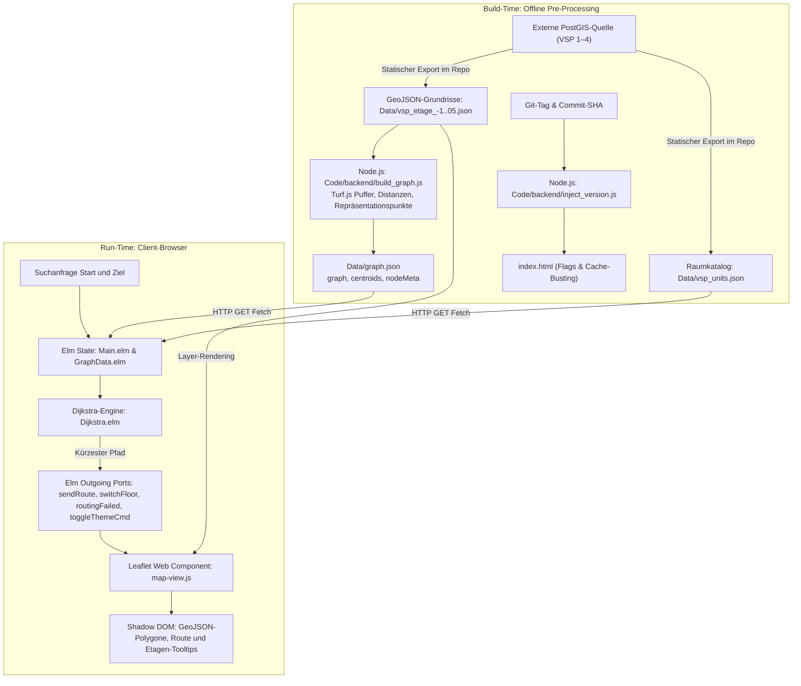

KrokenKompass setzt auf eine **strikte Trennung von Datenaufbereitung (Build-Time) und Laufzeitumgebung (Run-Time)**, um den Berechnungsaufwand zur Laufzeit zu minimieren und rein statisches Hosting zu ermöglichen.

---

## 🏛️ Systemübersicht & Verzeichnisstruktur



### Projektstruktur
```text
KrokenKompass/
├── index.html                        # App-Shell, Inline-Styles, Theme-Bootstrap & Elm-Port-Wiring
├── package.json                      # Build- und Entwicklungs-Skripte
├── vercel.json                       # Statisches Routing & HTTP-Security-/Cache-Header
├── Code/
│   ├── backend/
│   │   ├── build_graph.js            # Offline-Graphengenerator (GeoJSON → Data/graph.json)
│   │   └── inject_version.js         # Injektion von Git-Release/Commit-Flags in index.html
│   └── frontend/
│       ├── elm.json                  # Elm 0.19.1 Abhängigkeiten
│       ├── map-view.js               # Shadow DOM Web Component (<leaflet-map-container>)
│       ├── cssFiles/style.css        # Globale Theme-Variablen, Buttons & Responsive-Regeln
│       ├── svgs/                     # Logos (KK-Logo-dark.png, KK-Logo-Light.png)
│       └── src/
│           ├── Main.elm              # TEA State Machine, URL-Routing (#, #plan, #map), Views & Ports
│           ├── Dijkstra.elm          # Funktionaler Kürzeste-Wege-Algorithmus (shortestPath)
│           └── GraphData.elm         # JSON-Decoder für graph.json & Knotenpriorisierung (getBestNodeId)
├── Data/
│   ├── vsp_etage_-1.json .. 05.json  # Statische WGS84-GeoJSON-Grundrisse pro Etage
│   ├── vsp_units.json                # Statischer Raumkatalog für die Autocomplete-Suche
│   └── graph.json                    # Vorberechneter Routing-Graph
└── docs/                             # Projektdokumentation (automatischer Sync ins GitHub Wiki)
```

---

## 🛠️ Technologie-Stack

### 1. Datenvorbereitung & Pre-Processing (`Code/backend/`)
* **Node.js (v18+, CI: v24)**: Führt `build_graph.js` und `inject_version.js` zur Build-Zeit aus.
* **Turf.js (`@turf/turf` 7.4.0)**: Bibliothek für räumliche Geometrie-Operationen:
  * Ermittlung von Repräsentationspunkten innerhalb der Fläche (`turf.pointOnFeature` mit Fallback `turf.centroid`)
  * Pufferung von Polygonen (`turf.buffer` mit `1.0 m` bzw. `3.0 m`), um minimale CAD-Abstände zu überbrücken
  * Schnittpunktprüfungen (`turf.booleanIntersects`)
  * Geodätische Distanzberechnungen in Metern (`turf.distance`)

### 2. Frontend-Logik & Routing-Engine (`Code/frontend/src/`)
* **Elm (0.19.1)**: Rein funktionale, statisch typisierte Sprache für Webanwendungen.
  * **Keine Laufzeitausnahmen:** Elm verhindert `null`-/`undefined`-Fehler durch vollständige Fallunterscheidung (`Maybe`, `Result`) zur Kompilierzeit.
  * **Dijkstra-Algorithmus (`Dijkstra.elm`):** Berechnet kürzeste Wege über `Dijkstra.shortestPath` direkt im Browser.
  * **Dekodierung (`GraphData.elm`):** Parst `Data/graph.json` in typisierte `Dict String ...`-Strukturen und wählt über `getBestNodeId` den passenden Einstiegsknoten (`tuer` vor `flur` vor `vertikal` vor `raum`).

### 3. Visualisierung & Karten-Rendering (`Code/frontend/map-view.js`)
* **Leaflet.js (1.9.4) + Turf.js (6.5.0 via CDN)**: Gekapselt als Custom Element `<leaflet-map-container>` im Shadow DOM.
* **Ports-Brücke (`index.html`):** Elm steuert JavaScript unidirektional über vier ausgehende Ports (`sendRoute`, `switchFloor`, `routingFailed`, `toggleThemeCmd`).
* **Multi-Floor-Rendering:** Zeichnet Etagen-Polygone, berechnet weiche Polygon-Übergangspunkte (`berechneUebergang`) für die gestrichelte Routen-Polyline (`#EC4899`) und blendet an Treppen/Aufzügen permanente Etagenwechsel-Tooltips ein.

### 4. UI-Framework & Styling (`style.css` & `index.html`)
* **Bulma CSS (1.0.4)**: CSS-Basisframework für Layout und Typografie.
* **Custom CSS (`Code/frontend/cssFiles/style.css` & `index.html`)**: Such-Pills (`.route-pill`), Autocomplete-Dropdowns (`.search-dropdown`), schwebende Etagenauswahl (`#etagen-menue`) und Dark-/Light-Mode über `data-theme="dark" | "light"`.

---

## 🔄 Der vollständige Datenfluss

| Schritt | Phase | Beschreibung |
| :--- | :--- | :--- |
| **1. Grundrisse** | Statische Daten | Gebäudegrundrisse für Von-Seckendorff-Platz 1–4 (`7721`–`7724`) liegen als WGS84-GeoJSON (`Data/vsp_etage_-1.json` bis `vsp_etage_05.json`) sowie als Raumkatalog (`Data/vsp_units.json`) im Repository. |
| **2. Graph-Build** | Build-Time | `npm run build:graph` (`build_graph.js`) analysiert Polygonkontakte, vergibt Kantengewichte und Strafdistanzen und schreibt `Data/graph.json`. |
| **3. Initialisierung** | Ladezeit | Der Browser lädt `index.html`. Elm lädt `Data/graph.json` und `Data/vsp_units.json` per HTTP GET; `<leaflet-map-container>` lädt die GeoJSON-Etagenlayer. |
| **4. Suche & Auswahl** | Interaktion | Bei Eingabe in Start/Ziel filtert Elm die Raumnamen aus `vsp_units.json` sowie die Campus-Landmarks (`Campus Eingang Ost`, `Café Einstein`). |
| **5. Routing** | Laufzeit | Beim Absenden oder Aufruf einer `#map?start=...&ziel=...`-URL löst `GraphData.getBestNodeId` die Knoten auf, `Dijkstra.shortestPath` berechnet den Pfad und sendet ihn über `sendRoute` und `switchFloor`. |
| **6. Darstellung** | Rendering | `map-view.js` wechselt auf die Start-Etage, hebt Start- (`#22C55E`) und Zielraum (`#EF4444`) hervor, zeichnet die Route (`#EC4899`) über Polygon-Übergänge und passt den Kartenausschnitt (`fitBounds`) an. |

---
*Navigation:* [← 🎨 Zurück zu UI, Theming & Design-System](🎨-UI,-Theming-&-Design‐System) | [🖥️ Weiter zu Frontend & Elm-Architektur →](🖥️-Frontend-&-Elm‐Architektur)
