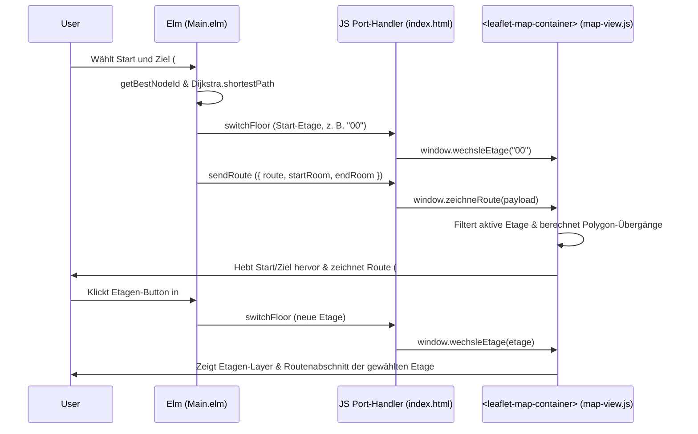

Das Frontend von **KrokenKompass** ist eine Single-Page-Application (SPA), die auf der **Elm-Architektur (TEA)** basiert und über **Ports** mit einem gekapselten **Leaflet.js-Web-Component** (`<leaflet-map-container>`) kommuniziert.

---

## 🏛️ Die Elm-Module (`Code/frontend/src/`)

```text
Code/frontend/src/
├── Main.elm        # State Machine (Model), URL-Router (Route), UI (View), Update-Logik & Ports
├── Dijkstra.elm    # Rein funktionale Dijkstra-Implementierung (shortestPath)
└── GraphData.elm   # JSON-Decoder für Data/graph.json & Knotenpriorisierung (getBestNodeId)
```

---

## 🧩 Modul-Details

### 1. `Main.elm` – Der Orchestrator & SPA-Router
* **Flags & Initialisierung:** Beim Start in `index.html` (`Elm.Main.init`) empfängt Elm ein `Flags`-Objekt `{ release : String, commit : String }`, das zur Build-Zeit von `Code/backend/inject_version.js` befüllt wird. Damit rendert der Footer die Release-Version (`v1.0.0`) und den Commit-Hash (`XXXXXXX`) mit Direktlinks zu GitHub.
* **URL-Fragment-Routing (`Route`):**
  * `#` (oder leer) → `Home` (Startseite mit Hero-Bereich und abstrakten Campus-Karten)
  * `#plan` → `Planner` (Routenplaner mit Start-/Ziel-Pills und Autocomplete)
  * `#map?start=<raum>&ziel=<raum>` → `Map RouteParams` (Interaktive Karte; berechnet die Route automatisch, sobald `Data/graph.json` geladen ist)
* **Model (`type alias Model`):** Verwaltet den gesamten Anwendungszustand:
  * `route : Route` (aktive Ansicht aus der URL)
  * `startInput : String`, `endInput : String` (aktuelle Eingabetexte für Start und Ziel)
  * `showStartDropdown : Bool`, `showEndDropdown : Bool` (Sichtbarkeit der Vorschlagslisten)
  * `graphData : Maybe GraphData` (der per HTTP geladene Wegegraph aus `Data/graph.json`)
  * `rooms : List ( String, String )` (formatierte Raumnamen und interne IDs aus `Data/vsp_units.json`)
  * `aktuelleEtage : String` (aktiv angezeigte Etage auf der Karte, z. B. `"00"`)
  * `errorMsg : Maybe String`, `shake : Bool` (Validierungs- und Fehlermeldungen)
  * `release : String`, `commit : String` (Versionsmetadaten für den Footer)
* **Autocomplete & Raumkatalog (`Data/vsp_units.json`):** Beim Start lädt `fetchVspUnits` den statischen Raumkatalog `Data/vsp_units.json` und formatiert interne Bezeichnungen (`"7723_00_039"`) über `formatRoomName` zu lesbaren Raumnamen (`"0.39 VSP 3"`), ergänzt um die Campus-Landmarks `"Campus Eingang Ost"` (`"7721_00_111"`) und `"Café Einstein"` (`"7723_00_010"`).

### 2. `Dijkstra.elm` – Der Pfadfinder
Eine rein funktionale Implementierung des Dijkstra-Algorithmus:
* **Signatur:**
  ```elm
  shortestPath : String -> String -> Graph -> Maybe (List String)
  ```
* **Ablauf:**
  1. Initialisiert die Kostentabelle (`Dict.singleton start 0.0`); noch unbesuchte Knoten erhalten beim Nachschlagen standardmäßig `1.0 / 0.0` (`Infinity`).
  2. Pflegt eine Vorgängertabelle (`Dict String String`), um den kürzesten Pfad nach Erreichen von `ziel` rückwärts zu rekonstruieren.
  3. Evaluiert rekursiv alle Nachbarkanten und wählt jeweils den unbesuchten Knoten mit den geringsten akkumulierten Kosten.
  4. Liefert `Just (List String)` mit der geordneten Folge der Knoten-IDs von `start` bis `ziel` (oder `Nothing`, falls kein zusammenhängender Pfad existiert).

### 3. `GraphData.elm` – Datenmodellierung & Einstiegspunkte
* **JSON-Decoder (`decodeGraphData`):** Parst `graph`, `centroids` und `nodeMeta` aus `Data/graph.json` in `Dict String ...`-Strukturen.
* **`getBestNodeId : String -> String -> GraphData -> Maybe String` (Smart Entry Node Selection):**  
  Da ein architektonischer Raum (z. B. `name = "7723_00_039"`) in den GeoJSON-Grundrissen sowohl als Raum-Polygon (`typ = "raum"`) als auch über seine zugehörigen Tür-Polygone (`typ = "tuer"`) abgebildet ist, wählt `getBestNodeId` anhand des übergebenen Wunschtyps (`zielTyp`) und einer festen Prioritätsreihenfolge den optimalen Einstiegsknoten, sodass Routen direkt an der Raumtür starten bzw. enden und die `+5000 m`-Raum-Transitstrafe vermeiden:
  $$\text{Priorität: } \text{Wunschtyp (\texttt{zielTyp})} > \text{Tür (\texttt{tuer})} > \text{Flur (\texttt{flur})} > \text{Vertikal (\texttt{vertikal})} > \text{Raum (\texttt{raum})}$$

---

## 🌉 Die Port-Schnittstelle (Elm → JavaScript)

Elm kommuniziert mit den Browser-APIs und dem Leaflet-Web-Component ausschließlich über vier typisierte **ausgehende Ports (`Cmd`)**, die in `index.html` abonniert werden:



### Definierte Outgoing Ports (`Main.elm`)
1. **`port sendRoute : { route : List String, startRoom : String, endRoom : String } -> Cmd msg`:** Übergibt die berechnete Knoten-ID-Liste sowie Start- und Zielraumname an `window.zeichneRoute` (und erfasst das Vercel-Analytics-Event `route_calculated`).
2. **`port switchFloor : String -> Cmd msg`:** Wechselt über `window.wechsleEtage` die angezeigte Etage in Leaflet (und erfasst das Event `switch_floor`).
3. **`port routingFailed : String -> Cmd msg`:** Meldet fehlgeschlagene Routenberechnungen (und erfasst das Event `route_failed`).
4. **`port toggleThemeCmd : () -> Cmd msg`:** Ruft `window.toggleTheme()` auf, schaltet `document.documentElement[data-theme]` zwischen `"light"` und `"dark"` um und speichert die Auswahl in `localStorage`.

---

## 🗺️ Karten-Rendering (`Code/frontend/map-view.js`)

* **Shadow DOM Web Component (`<leaflet-map-container>`):** Kapselt die Leaflet-Instanz und bleibt im DOM persistent (`#map-background`), sodass die 7 GeoJSON-Etagenlayer nur einmalig geladen werden müssen. Ein `ResizeObserver` ruft beim Einblenden automatisch `map.invalidateSize()` auf.
* **Weiche Polygon-Übergänge (`berechneUebergang`):** Statt Luftlinien zwischen Polygon-Mittelpunkten zu ziehen, berechnet `map-view.js` mithilfe von **Turf.js 6.5.0** die Schnittmenge aufeinanderfolgender Polygone derselben Etage (exakter Schnitt bzw. `0.2 m`-, `1.0 m`- und `3.0 m`-Puffer) und führt die gestrichelte Routenlinie (`#EC4899`) direkt durch die Tür- und Flurübergänge.
* **Etagenwechsel-Hinweise (`L.circleMarker`):** Wechselt der berechnete Pfad über einen `vertikal`-Knoten (Treppe/Aufzug) die Etage, platziert `map-view.js` einen pinken Kreismarker (`#EC4899`) mit permanentem Tooltip (`"Hier Etage wechseln (nach XX)"` bzw. `"Von Etage XX kommend"`).
* **Farb-Codierung der Polygone (`gibFeatureStyle`):**
  * **Aktive Route:** Pink gestrichelt (`#EC4899`)
  * **Startraum (`START_RAUM`):** Grün (`#22C55E`, Rand `#16A34A`)
  * **Zielraum (`ZIEL_RAUM`):** Rot (`#EF4444`, Rand `#DC2626`)
  * **Portale (`tuer` / `eingang` / `durchgang` / `lobby`):** Amber (`#F59E0B`)
  * **Vertikal (`vertikal` – Treppen/Aufzug):** Violett (`#A78BFA`, Rand `#8B5CF6`)
  * **Flure (`flur`):** Grau (`#A8A29E`)
  * **Standardräume (`raum`):** Blau (`#3388FF`, Rand `#4A4A4A`)

---
*Navigation:* [← 🏗️ Zurück zu Architektur & Technologien](🏗️-Architektur-&-Technologien) | [🚀 Weiter zu Deployment & CI/CD-Pipelines →](🚀-Deployment-&-CI-CD-Pipelines)
