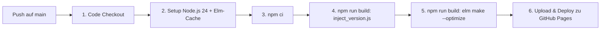
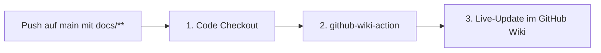

KrokenKompass wird automatisiert sowohl auf **GitHub Pages** als auch auf **Vercel** bereitgestellt. Zusätzlich prüft eine CI-Pipeline (`.github/workflows/ci.yml`) jeden Pull Request auf `main`.

---

## ⚙️ 1. GitHub Pages & CI-Pipelines (`.github/workflows/`)

Bei jedem Push auf `main` führt `.github/workflows/deploy.yml` das Deployment auf GitHub Pages aus (während `.github/workflows/ci.yml` bei Pull Requests sowohl `npm run build` als auch `node Code/backend/build_graph.js` validiert):



### Die Workflow-Schritte im Detail
1. **Versions- & Release-Injektion (`inject_version.js`):**
   - **Release-Version:** Ermittelt das aktuelle GitHub-Release bzw. Git-Tag (`GITHUB_REF_NAME` oder `git describe --tags --abbrev=0`, Fallback `version` aus `package.json`).
   - **Commit-Hash:** Ermittelt den 7-stelligen Commit-Hash (`VERCEL_GIT_COMMIT_SHA`, `GITHUB_SHA` oder `git rev-parse --short HEAD`).
   - **Strukturierte Flags:** Schreibt `flags: { release: "vX.X.X", commit: "XXXXXXX" }` in `index.html`, sodass im Footer `vX.X.X - XXXXXXX` mit Links zu Release und Commit angezeigt wird.
   - **Cache-Busting:** Aktualisiert automatisch die Query-Parameter `elm.js?v=`, `map-view.js?v=` und `style.css?v=` in `index.html`.
2. **Elm-Kompilierung (`elm make`):**
   - Kompiliert `Code/frontend/src/Main.elm` mit dem `--optimize`-Flag nach `Code/frontend/elm.js`.

---

## ▲ 2. Vercel Deployment

Vercel erstellt Preview-Deployments für Pull Requests sowie Production-Deployments für `main`.

### Konfigurationsdateien

#### `package.json`
Definiert die Build- und Entwicklungs-Skripte:
```json
{
  "scripts": {
    "dev": "npx serve .",
    "start": "npx serve .",
    "build": "npm run build:all",
    "build:elm": "node Code/backend/inject_version.js && cd Code/frontend && npx elm make src/Main.elm --output=elm.js --optimize",
    "build:graph": "node Code/backend/build_graph.js",
    "build:all": "npm run build:elm"
  },
  "devDependencies": {
    "elm": "^0.19.1-6"
  },
  "dependencies": {
    "@turf/turf": "^7.4.0"
  }
}
```

#### `vercel.json`
Da KrokenKompass eine statische Single-Page-Application mit `index.html` im Hauptverzeichnis ist, definiert `vercel.json` das Root-Verzeichnis als Output sowie HTTP-Sicherheits- und Cache-Header:
```json
{
  "outputDirectory": ".",
  "cleanUrls": true,
  "trailingSlash": false,
  "headers": [
    {
      "source": "/(.*)",
      "headers": [
        {
          "key": "X-Content-Type-Options",
          "value": "nosniff"
        },
        {
          "key": "X-Frame-Options",
          "value": "SAMEORIGIN"
        },
        {
          "key": "Referrer-Policy",
          "value": "strict-origin-when-cross-origin"
        }
      ]
    },
    {
      "source": "/(index\\.html)?",
      "headers": [
        {
          "key": "Cache-Control",
          "value": "public, max-age=0, must-revalidate"
        }
      ]
    },
    {
      "source": "/Data/(.*)",
      "headers": [
        {
          "key": "Cache-Control",
          "value": "public, max-age=3600, stale-while-revalidate=86400"
        }
      ]
    },
    {
      "source": "/Code/(.*)",
      "headers": [
        {
          "key": "Cache-Control",
          "value": "public, max-age=86400, stale-while-revalidate=604800"
        }
      ]
    }
  ]
}
```

#### Vercel Web Analytics & Speed Insights
KrokenKompass bindet Vercel Web Analytics sowie Vercel Speed Insights im `<head>` der `index.html` ein:
```html
<!-- Vercel Web Analytics & Speed Insights -->
<script>
    window.va = window.va || function () { (window.vaq = window.vaq || []).push(arguments); };
    window.si = window.si || function () { (window.siq = window.siq || []).push(arguments); };
</script>
<script defer src="/_vercel/insights/script.js"></script>
<script defer src="/_vercel/speed-insights/script.js"></script>
```
* **Core Web Vitals:** Speed Insights erfasst Leistungskennzahlen (LCP, INP, CLS).
* **Custom Events:** Die Port-Handler in `index.html` senden anonymisierte Nutzungsereignisse:
  - `route_calculated`: Erfolgreiche Berechnung und Darstellung einer Route
  - `route_failed`: Fehlgeschlagene Routensuche
  - `switch_floor`: Wechsel der angezeigten Etage (`{ floor: ... }`)

---

## 🔄 3. GitHub Wiki Sync Pipeline (`.github/workflows/wiki-sync.yml`)

Änderungen an der Dokumentation werden im Verzeichnis `docs/` über Commits und Pull Requests gepflegt. Bei jedem Push auf `main`, der Dateien unter `docs/**` ändert, spiegelt `.github/workflows/wiki-sync.yml` die Markdown-Dateien in das GitHub Wiki (`.wiki.git`):



---

## 🛡️ 4. Warum `elm.js` in `.gitignore` steht

* **Keine generierten Build-Artefakte in der Versionsverwaltung:** `Code/frontend/elm.js` wird beim Build vollständig aus `Code/frontend/src/*.elm` generiert.
* **Deterministische Builds:** Durch die Ausführung von `npm run build` in GitHub Actions und Vercel wird `elm.js` bei jedem Deployment frisch aus dem aktuellen Quellcode kompiliert.

---
*Navigation:* [← 🖥️ Zurück zu Frontend & Elm-Architektur](🖥️-Frontend-&-Elm‐Architektur) | [🛠️ Weiter zu Installation & Developer Guide →](🛠️-Installation-&-Developer-Guide)
